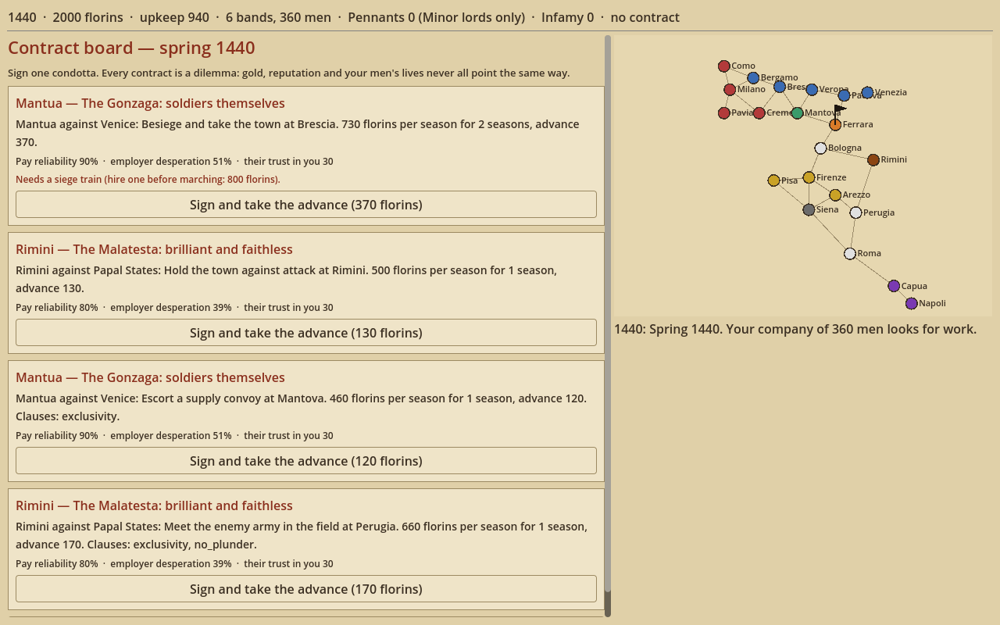
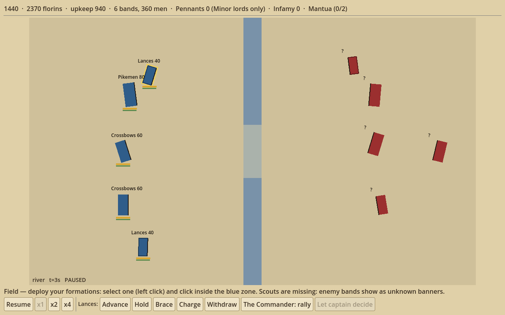

# Condottiere

A roguelite management-strategy game: run a mercenary company in 1440s Italy, sell it to
warring city-states, and decide every season whether loyalty or betrayal pays better.

This repository is the **prototype phase** of the design doc *Condottiere — Game Design
Draft* (months 1–2: a grey-box sim of one full yearly loop). It is built in **Godot 4.3
with GDScript**, as the doc's tech-stack section specifies.




## Run it

1. Install [Godot 4.3](https://godotengine.org/download) (standard build, not .NET).
2. Open `project.godot` in Godot, or run `godot --path .` from this folder.
3. Press **New campaign**. A blank seed picks a random one; the same seed replays the same run.

## What's in the prototype

The full yearly loop from the doc, spring 1440 to the Peace of Lodi in 1454:

| Step | What you do |
| --- | --- |
| Contract board | Sign 1 of 3–4 condotte (employer, pay, 25% advance, 1–3 season term, objective, clauses) or wait |
| Prepare company | Hire, refill, dismiss bands; assign captains; pick the 5 bands that take the field; buy goods |
| March and events | Letters with choices; a rival may try to buy your company (**betrayal**); enemy condottieri may offer a **sham battle** |
| Battle or siege | Real-time 2D formation battle with pause, or a weekly siege (bombard, starve, bribe, storm the breach) |
| Aftermath | Ransom, recruit or release prisoners; ransom your own captured men |
| Payday | Paid, paid late, or defaulted, by each employer's personality |
| Winter quarters | Upkeep, desertion rolls, captain loyalty and defection, winter letters, lordship chances, retirement |

Systems implemented from the doc:

- **Offer formula** `Upkeep × (1.1 + 0.4 × Desperation) × (1 + 0.03 × Pennants) × Reliability`
- **Combat model** `Losses/s = k × Attack × Matchup × Facing / (Defence + Armour)`, facing 1 / 1.5 / 2,
  k tuned so an even frontal pike fight lasts about 60–70 s
- Battles: formations as blocks at a fixed 20 ticks per second, orders (advance, hold, brace,
  charge, withdraw, hold fire), charge impact and braced pikes, flanks and gaps, fatigue,
  morale, rout, pursuit and rally, reserves, captain abilities (rally, countercharge,
  steady volley), scouting and unknown banners, terrain (hills, woods, river, breach), rain
- Pennant tiers gate who hires you; Infamy (0–100) closes doors and draws assassins
- Desertion `15% per unpaid season − captain Loyalty ÷ 10 points`; captains under 25 Loyalty defect with their bands
- A living world: powers declare war, besiege and take towns, go broke and make peace;
  towns produce grain, iron and horses, and scarcity raises local recruit prices
- Endings: Lordship (20+ pennants), Captain-General, Retirement; losses: ruin, execution,
  commander dead with no loyal successor (a successor takes over with a loyalty penalty)
- JSON saves (save at Prepare or Winter; the saved game resumes at that phase)

## Layout

| Path | Contents |
| --- | --- |
| `sim/` | All rules as pure code, no scene dependencies, so they run headless |
| `data/` | Troops, employers, provinces, traits and events as hand-edited JSON |
| `ui/` | Grey-box presentation: reads sim state and sends player commands |
| `tools/balance_harness.gd` | Auto-plays campaigns headless and exports CSV |
| `tools/analyze_balance.py` | Reads the CSVs and reports the doc's tuning targets |
| `tests/run_tests.gd` | Headless tests |

## Tests and balance

```sh
godot --headless --path . --script res://tests/run_tests.gd
godot --headless --path . --script res://tools/balance_harness.gd -- --runs 200 --seed 1 --out balance_out
python3 tools/analyze_balance.py balance_out
```

The harness plays three auto-player policies: `honest` (never betrays), `mixed` and
`betrayer`. A 30-run sample at the current values:

| Policy | Win rate | Seasons ending with < 1 season of upkeep | Highest pennant tier (avg) |
| --- | --- | --- | --- |
| honest | 53% | 35% | 2.0 |
| mixed | 37% | 30% | 1.8 |
| betrayer | 13% | 38% | 1.2 |

Against the doc's targets: runs with zero betrayals are winnable, low-bank seasons are near
the ~40% target, and betrayal costs about one pennant tier where the doc asks for about two.
All numbers are placeholders for tuning. A headless battle takes about 0.4 s, so 10,000
seasons run in well under an hour; the doc's plan to move the battle hot path to C++ can wait
until profiling needs it.

## Differences from the doc, for this phase

- Campaign and save state are JSON rather than SQLite; the SQLite schema is for the vertical slice.
- The map has 21 towns and all 9 employers (the slice targets 12 provinces), because the
  living-world rules need enough borders to move.
- Meta-progression, localization, Steam integration and Windows exports are later phases.
